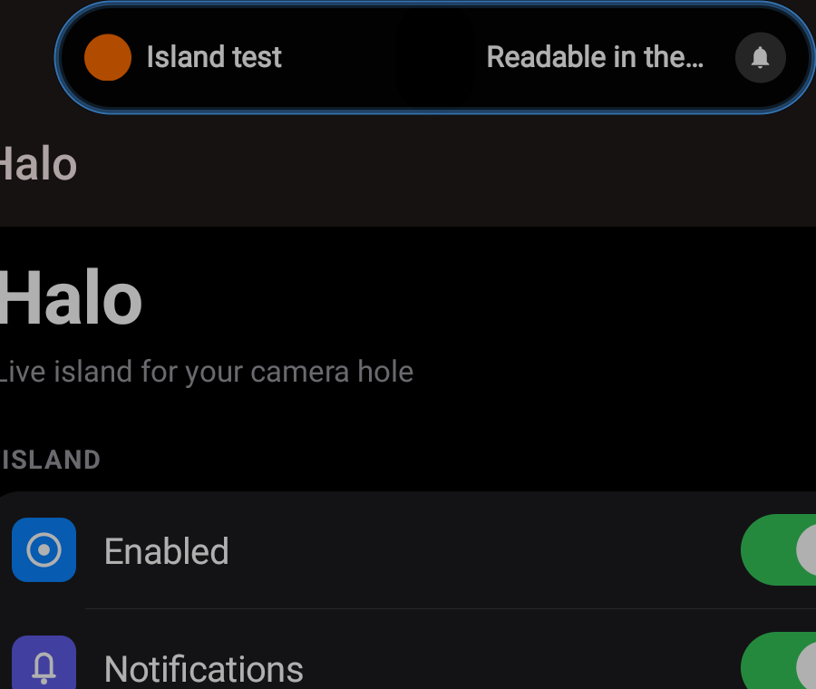
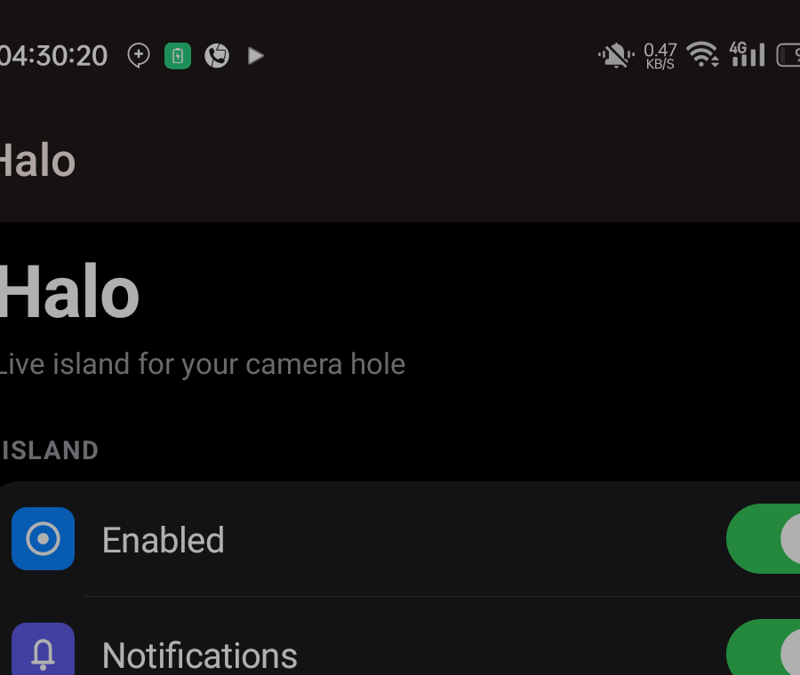
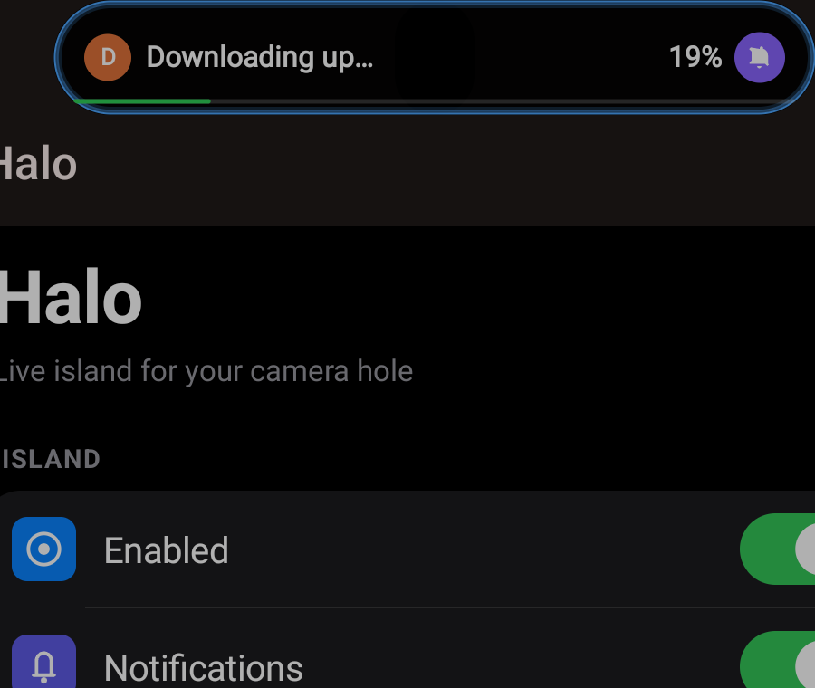
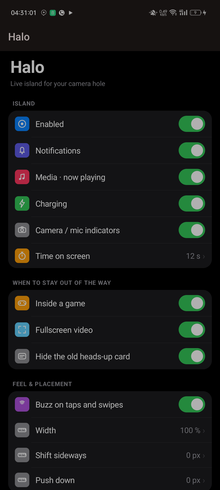

# Halo

A Dynamic-Island-style pill for Android phones with a centred camera hole-punch — written from
scratch as an [LSPosed](https://github.com/LSPosed/LSPosed) module, tuned for ColorOS 13 on the
OPPO A79 5G (CPH2553).

One APK holds both halves: the module that injects a single overlay window into
`com.android.systemui`, and the settings app that configures it. No AndroidX, no Compose, no
tracking, no network permission. Everything is drawn on a `Canvas`.

```
  ┌───────────────────────────┐
  │  ◉  Rafiq · order 4192    │   ← capsule, expands from the camera hole
  │      56%                  │
  └───────────────────────────┘
```

## See it first

Every picture below is generated by `sh tools/capture-gallery.sh` from the app's own synthetic test
states, so nothing in them is anyone's real message.

| | |
|---|---|
|  | **A message arrives.** The hole widens into a capsule: app icon or sender photo, subject, and a bell when the row is silent. Swipe up on it to dismiss. |
|  | **A burst of them.** Four rows stack under a shaking bell, each one swipes away on its own; the count in the header follows. |
|  | **One tap to read.** The paragraph wraps to the width of the card and the notification's own buttons become chips — Reply, Mark as read, Open all fire the real intents. |
|  | **Something is actually transferring.** A green line and a percentage, and only when the app declares a scale and the row is a running task. |
|  | **An incoming call.** Answer and hang up as discs; once you answer, the same slot folds into a green ring. |
|  | **Nothing else is happening.** A light sweeps around the hole while music plays; tap it for the player. |
|  | **The settings app.** Grouped cards, switches that behave like iPhone's, and a sheet for every number. |

## What it does

| | |
|---|---|
| **Notifications** | The newest message expands the hole into a capsule: sender photo or initial, subject, a bell for silent rows. Swipe up to dismiss. |
| **A burst of messages** | Three or four rows stack into a list card with a shaking bell on the left; each row swipes away on its own. |
| **One tap to open** | A single message opens a detail card with the paragraph word-wrapped and the notification's own action buttons as chips (Reply / Mark as read / Open). |
| **Media** | Now-playing becomes a floating mini-player with artwork, transport controls and a seek line; while nothing else is up, a light keeps sweeping around the hole. |
| **Downloads** | A real progress bar and `NN%` — only when the app declares a scale and the row is an actual running task. |
| **Calls** | An incoming call gets a card with answer and hang-up discs; after you answer, the same slot becomes a green ring. |
| **Charging** | Percentage, plug/unplug, and a red ring at low battery. |
| **Privacy** | A coloured dot when any app touches the camera, microphone or location — read from SystemUI's own privacy list and AppOps. |
| **Screen recording** | A capsule while a recording is active. |
| **Face unlock** | One sweep of light around the hole when the device unlocks. |
| **Games and fullscreen video** | The island gets out of the way: Game Space's own session flag, and WindowManager's `setTopAppHidesStatusBar`. |
| **Automation** | Any app, Tasker, Termux or `adb` can put a capsule on screen — see the API below. |

## Compatibility — read this before you install

**Built and tested on exactly one phone**: OPPO A79 5G, model **CPH2553**, ColorOS **13.1** over
Android **13**, rooted with Magisk, LSPosed **2.2.1**, libxposed API **102**. Nothing in this
repository has been run anywhere else. There is no compatibility promise for any other Oppo,
Realme, OnePlus or Xiaomi device, and "it's the same OEM" is not a guarantee.

What each part depends on, so you can judge your own device:

| part | depends on | elsewhere |
|---|---|---|
| Geometry of the pill | `WindowInsets.getDisplayCutout()` — measured, never hardcoded | should adapt; the fractions were tuned on a 1080x2400 panel |
| Notification capture | `com.android.systemui.notification.NotifCollection` (AOSP-named) | works on AOSP-derived SystemUI; some forks rename or wrap it |
| Heads-up suppression | `com.oplusos.systemui.notification.helper.HeadsUpHelper` and `SimpleHeadsUpController` | **ColorOS / Realme UI only.** Elsewhere the hook simply never attaches: the island still shows, and the OEM banner shows next to it |
| Hide in games | `Settings.Global/disturb_for_game_space_mode_flag` | **ColorOS only.** Other ROMs read 0 forever and the island stays visible in games |
| Hide in fullscreen video | `CommandQueue#setTopAppHidesStatusBar` | AOSP since Android 11, the most portable of the four |
| Privacy dots | `com.android.systemui.privacy.PrivacyItemController` | AOSP since Android 12, but the package layout moves between releases |
| Media, calls, charging | public framework APIs | portable |
| Sender photos | `android.messages` as a `Bundle[]`, `Person.getName()` | measured on this ROM; other builds may use the real `MessagingStyle` |

Realme UI ships the same Oplus framework as ColorOS, so a Realme phone is the *most likely* to
work — that is an inference from shared code, not a measurement. Android 14 and 15 are untested
and `targetSdk` is 33 on purpose.

If the island does not appear on your device, do this before opening an issue:

```bash
adb shell su -c 'pm grant io.github.lamin_sudo.halo android.permission.WRITE_SECURE_SETTINGS'
adb shell su -c 'settings put global a79_island_debug_log 1'
adb shell su -c 'kill $(pidof com.android.systemui)'
adb logcat -s HaloIsland | head -40
```

The first lines say which hooks attached and which were not found — that output is the useful part
of a report.

## Requirements

- Rooted phone with **LSPosed** (tested on 2.2.1, libxposed API 102) and **Riru/Zygisk** provider.
- Android 13 (minSdk 33). Verified on ColorOS 13.1 / CPH2553. Other OEMs are untested: the hook
  targets are AOSP-named on purpose, but the *geometry* and the heads-up gate are ColorOS-specific.
- The module injects into `com.android.systemui` only. It never touches `system_server`.

## Install

```bash
sh gradlew :app:assembleRelease
adb install -r app/build/outputs/apk/release/app-release.apk

# give the settings app the one permission it needs to write its own config
adb shell su -c 'pm grant io.github.lamin_sudo.halo android.permission.WRITE_SECURE_SETTINGS'

# reload SystemUI so the hooks attach
adb shell su -c 'kill $(pidof com.android.systemui)'
```

Then open **LSPosed → Modules**, enable *Halo*, set its scope to **SystemUI**, and reboot once.
`tools/install-release.sh` does all of the above, checks the signing certificate, and prints the
LSPosed step it cannot do for you.

## The kill switch

If the island ever misbehaves, no reinstall is needed:

```bash
adb shell su -c 'settings put global a79_island_disabled 1'   # module stands down on next boot of SystemUI
adb shell su -c 'settings put global a79_island_disabled 0'   # back on
```

## Automation API

```bash
adb shell am broadcast -n io.github.lamin_sudo.halo/.CustomReceiver -a io.github.lamin_sudo.halo.CUSTOM \
  --es title "Order shipped" --es text "#4192 to Rafiq" \
  --ei progress 60 --ei ttl 8 --es color 0xFF30D158 --es key order-4192
```

`-n` (or at least `-p io.github.lamin_sudo.halo`) is required — an implicit broadcast to a custom action is
dropped since Android 8. In Tasker, use *Send Broadcast* with the package field filled in. Repeat
the same message and it shows again: the receiver bumps a sequence number, that is the event.

## Settings

Stored in `Settings.Global` under `a79_island_*` because that is the one place the hooked SystemUI
process can read; changes apply live through a `ContentObserver`, no restart.

| key | meaning | default |
|---|---|---|
| `enabled` | master switch | on |
| `src_notification`, `src_media`, `src_charging`, `privacy` | per-source switches | on |
| `haptics` | buzz on taps and swipes | on |
| `games_hide` | hide while Game Space owns the screen | on |
| `immersive_hide` | hide while the top app hides the status bar | on |
| `hide_heads_up` | suppress ColorOS's own banner | off |
| `ttl_ms` | how long a capsule stays up | 5000 |
| `offset_x`, `offset_y`, `width_scale` | placement, in px and % | 0, 0, 100 |
| `allow_<pkg>` | per-app gate | allowed |
| `debug_log` | verbose logcat under tag `HaloIsland` | off |

## Known limits, stated plainly

- **Recorder with the microphone off is not detected.** ColorOS records without a
  MediaProjection token, so the only signal that survives is the microphone op.
- **Fullscreen detection is per-signal.** Games and "the top app hides the bar" are both real
  WindowManager/Game Space facts. A video that keeps the status bar visible is not fullscreen as
  far as the system is concerned, and the island stays.
- **Rows cannot be swiped away for apps that set no `deleteIntent`** — `NotificationManager`
  offers no public per-key cancel on this build.
- **Sender photos depend on the app.** `android.messages` arrives as a `Parcelable[]` of Bundles
  on this ROM and `Person` exposes `getName()` rather than `getDisplayName()`; apps that send
  neither fall back to the app icon.
- **Battery cost is not measured yet.** `tools/battery-soak.sh` exists (two equal idle windows,
  module off vs the ring sweeping) but has not been run. Until it is, treat the ambient ring as
  unquantified — which is why the media ring only runs while something is actually playing.

## Documentation

- `docs/HOW-IT-WORKS.md` — the hook map, every measurement that shaped it, and the four routes
  that failed before the right signal was found.
- `NOTICE` — the two external sources, and the line between "measured this device" and
  "copied proprietary code" (there is none of the latter here).
- `AGENTS.md` — the rules for anyone continuing the work, including the Kotlin/interceptor trap
  that crashed SystemUI twice.

## Licence

MIT. See `NOTICE` for the third-party work this was built against.
